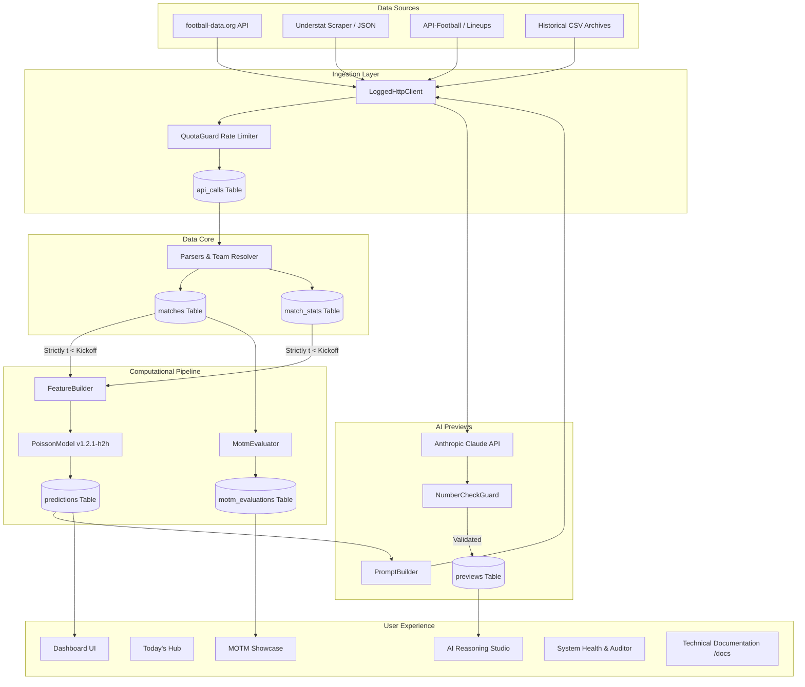

<div align="center">


# XPECT

### Verified European Football Analytics, Dixon-Coles Poisson Probabilities & AI Match Previews

[](https://php.net)
[](https://laravel.com)
[](https://sqlite.org)
[-3DDC84?style=flat-square&logo=checkmarx&logoColor=white)](tests/)
[-D94E00?style=flat-square)](app/Console/Commands/AuditDataCommand.php)
[](LICENSE)

<br/>

**Xpect** is a local-only computational football analytics and prediction engine covering the top 5 European leagues (*Premier League, La Liga, Bundesliga, Serie A, and Ligue 1*). It aggregates verified match results and expected goals (xG), computes rigorous rolling form features strictly prior to kickoff ($t < \text{kickoff}$), calculates win/draw/loss probabilities via an advanced bivariate Dixon-Coles Poisson distribution, and uses Anthropic's Claude 3.5 Sonnet to generate structured, plain-language match previews without hallucinated figures.

</div>

---

## 📑 Table of Contents

- [Architectural Philosophy & Core Invariants](#-architectural-philosophy--core-invariants)
- [League & Data Coverage](#-league--data-coverage)
- [The 5-Stage Prediction Engine](#-the-5-stage-prediction-engine)
- [Man of the Match (MOTM) Engine (Stats vs. Story)](#-man-of-the-match-motm-engine-stats-vs-story)
- [AI Reasoning Studio & Number Check Guard](#-ai-reasoning-studio--number-check-guard)
- [System Architecture & Data Flow](#-system-architecture--data-flow)
- [Artisan CLI Command Reference](#-artisan-cli-command-reference)
- [User Interface & Design System](#-user-interface--design-system)
- [Custom Error Pages](#-custom-error-pages)
- [Installation & Quickstart Guide](#-installation--quickstart-guide)
- [Testing & Integrity Auditing](#-testing--integrity-auditing)
- [Directory Structure](#-directory-structure)
- [License](#-license)

---

## 🏛 Architectural Philosophy & Core Invariants

Xpect was constructed around four inviolable engineering principles:

1. **Zero Data Leakage Invariant:** Every statistic, expected goal value, or historical outcome calculated for a fixture is computed **strictly and exclusively** from matches finalized prior to that fixture's kickoff time ($t < \text{kickoff}$). No future information leaks into team form or strength ratings.
2. **The Math Decides, The AI Explains:** Statistical models dictate 100% of the outcome probabilities ($\mathbb{P}(\text{Home}), \mathbb{P}(\text{Draw}), \mathbb{P}(\text{Away})$). The Large Language Model receives structured JSON only and cannot alter probabilities, fabricate outside facts, or hallucinate metrics.
3. **Permanent Auditability & Immutability:** Outbound HTTP requests, raw API payloads, generated predictions, and historical model evaluations are strictly append-only. Rows in `predictions` and `api_calls` are never mutated or deleted.
4. **Deterministic Local Execution:** Zero multi-tenant complexity, zero cloud dependencies, and zero credentials stored in application logs or database tables. All keys live securely in `.env`.

---

## 🌍 League & Data Coverage

Xpect maintains unified, canonical coverage across all **Top 5 European Leagues** spanning from **2020 through 2027**:

| League | Country | Total Matches | Finished Matches | Timeline Range | xG Source Coverage |
|---|---|---|---|---|---|
| **Premier League** | England | 2,280 | 1,980 | 2020-09-12 → 2027-05-30 | 96% Understat Blend |
| **La Liga** | Spain | 2,280 | 1,999 | 2020-09-12 → 2027-05-30 | Historical Goals & Standings |
| **Bundesliga** | Germany | 1,836 | 1,593 | 2020-09-18 → 2027-05-22 | Historical Goals & Standings |
| **Serie A** | Italy | 2,280 | 1,988 | 2020-09-19 → 2027-05-30 | Historical Goals & Standings |
| **Ligue 1** | France | 2,058 | 1,824 | 2020-08-21 → 2027-05-29 | Historical Goals & Standings |
| **Total** | **5 Leagues** | **10,734** | **9,384** | **7 Seasons** | **3,800+ Advanced xG Records** |

---

## 🔬 The 5-Stage Prediction Engine

Xpect's core prediction engine (`App\Services\Models\PoissonModel` & `App\Services\Features\FeatureBuilder`) implements an advanced **Bivariate Dixon-Coles Poisson Distribution (`v1.2.1-h2h`)** through five mathematical stages:

```
[Raw Match History]
        │
        ▼ (Stage 1: Exponential Form Decay & Sustainable xG Blend)
[Weighted Form Features]
        │
        ▼ (Stage 2: Attack & Defence Relative Strengths)
[Team Ratings α_H, β_H, α_A, β_A]
        │
        ▼ (Stage 3: Poisson Rate Parameters + H2H Bayesian Walk-Forward)
[Expected Goals λ_H, λ_A]
        │
        ▼ (Stage 4: Dixon-Coles Bivariate Low-Score Correction Matrix τ)
[Adjusted 6×6 Scoreline Grid]
        │
        ▼ (Stage 5: Scoreline Aggregation & Boundary Normalization)
[P(Home), P(Draw), P(Away)]
```

### Stage 1: Feature Extraction & Sustainable xG Blend
For any match $m$ with kickoff $T$, form is computed over a rolling 20-match window with exponential half-life time decay ($t_{1/2} = 60\text{ days}$):
$$w_i = \exp\left(-\frac{\ln(2)}{60} \cdot \Delta t_i\right)$$
Offensive and defensive output combines actual goals and expected goals (xG) using a 70% sustainable underlying performance blend:
$$\text{Offensive Metric} = 0.30 \cdot G_{\text{scored}} + 0.70 \cdot xG_{\text{for}}$$

### Stage 2: Attack & Defence Relative Strengths
$$\alpha_H = \frac{\bar{G}_{\text{scored, home}}}{\bar{G}_{\text{league home}}}, \quad \beta_H = \frac{\bar{G}_{\text{conceded, home}}}{\bar{G}_{\text{league away}}}$$
$$\alpha_A = \frac{\bar{G}_{\text{scored, away}}}{\bar{G}_{\text{league away}}}, \quad \beta_A = \frac{\bar{G}_{\text{conceded, away}}}{\bar{G}_{\text{league home}}}$$

### Stage 3: Rate Parameters & Head-to-Head Walk-Forward
Baseline expected goals incorporate league home advantage $\gamma$:
$$\lambda_H = \alpha_H \cdot \beta_A \cdot \bar{G}_{\text{league home}} \cdot \eta_{\text{h2h, home}}$$
$$\lambda_A = \alpha_A \cdot \beta_H \cdot \bar{G}_{\text{league away}} \cdot \eta_{\text{h2h, away}}$$

### Stage 4: Dixon-Coles Bivariate Low-Score Correction
Standard independent Poisson models systematically underestimate low-scoring draws ($0-0$) and low-scoring home/away wins ($1-0, 0-1, 1-1$). Xpect applies the Dixon & Coles (1997) adjustment factor $\tau(x, y)$ with active parameter $\rho = -0.06$:
$$\tau(x, y) = \begin{cases} 1 - \lambda_H \lambda_A \rho & \text{if } x = 0, y = 0 \\ 1 + \lambda_A \rho & \text{if } x = 0, y = 1 \\ 1 + \lambda_H \rho & \text{if } x = 1, y = 0 \\ 1 - \rho & \text{if } x = 1, y = 1 \\ 1 & \text{otherwise} \end{cases}$$
$$\mathbb{P}(X = x, Y = y) = \tau(x, y) \cdot \frac{\lambda_H^x e^{-\lambda_H}}{x!} \cdot \frac{\lambda_A^y e^{-\lambda_A}}{y!}$$

### Stage 5: Matrix Aggregation
Probabilities are integrated across the discrete $6 \times 6$ bivariate score grid ($x, y \in [0, 5]$) and normalized:
$$\mathbb{P}(\text{Home Win}) = \sum_{x > y} \mathbb{P}(x, y), \quad \mathbb{P}(\text{Draw}) = \sum_{x = y} \mathbb{P}(x, y), \quad \mathbb{P}(\text{Away Win}) = \sum_{x < y} \mathbb{P}(x, y)$$

---

## 🌟 Man of the Match (MOTM) Engine (Stats vs. Story)

Xpect features an advanced **Dual-Engine Man of the Match Evaluation System** (`App\Services\Motm\MotmEvaluator`) modeling both the quantitative statistical performance and broadcaster/panel narrative factors:

1. **Statistical Data Rating (0–10 Scale):** Pure objective metrics modeled after Opta, SofaScore, and WhoScored algorithms:
   - Goals scored ($+1.8$ to $+2.2$) & Assists ($+1.2$)
   - Key passes, progressive carries & big chances created ($+0.3$ to $+0.5$)
   - Defensive clearances, interceptions & tackles won ($+0.25$ to $+0.4$)
   - Goalkeeper saves & clean sheets ($+0.4$ per save, $+1.2$ for shutouts)
2. **Broadcaster / Panel Decision Score:** Reflects narrative and human voting factors:
   - **Winning Team Bias:** Panel awards skew heavily toward the winning squad ($+1.0$ boost).
   - **Decisive Strikes:** Game-winning goals and clutch late strikes receive priority weighting.
   - **Brace & Hat-Trick Primacy:** Multi-goal performances supersede quiet midfield contributions.
   - **Goalkeeper High-Pressure Heroics:** Clean sheets under severe barrage ($xGA > 1.80$) are boosted.
3. **Strict Single-Winner Invariant:** Exactly **one** player per completed fixture is awarded the official MOTM accolade with full rationales and 22-player squad ratings.

---

## 🤖 AI Reasoning Studio & Number Check Guard

Xpect integrates Claude 3.5 Sonnet to author natural, tactical match previews. To prevent AI hallucinations, the pipeline employs a deterministic two-pass security architecture:

1. **Structured-Only Prompt Payload:** The prompt builder (`App\Services\Previews\PromptBuilder`) feeds structured form stats, expected goals, Poisson percentages, and recent scorelines.
2. **Number Check Guard (`App\Services\Previews\NumberCheckGuard`):** Before any LLM response is persisted to the database or displayed in the UI, an automated regex inspector parses every single numeric figure in the generated text. If the LLM mentions an unverified number (e.g., claiming a striker scored 24 goals when the dataset says 17), the check flags a security failure and rejects the preview.

---

## 📊 System Architecture & Data Flow



---

## ⌨️ Artisan CLI Command Reference

All system operations can be executed directly through clean Laravel Artisan commands:

```bash
# --- Data Integrity & Automated Timeline Audit ---
php artisan audit:data                      # Verify 8 integrity domains & zero data leakage
php artisan xpect:backup                    # Create timestamped SQLite database snapshot

# --- Statistical Predictions & Matchday Ops ---
php artisan xpect:predict {match_id}        # Generate Dixon-Coles Poisson prediction
php artisan xpect:refresh-matchday          # Batch-refresh all upcoming fixtures for current matchday
php artisan xpect:evaluate-predictions      # Score finished predictions (Log Loss, Brier, Accuracy)

# --- Historical Backtesting & Benchmarks ---
php artisan xpect:backtest                  # Run walk-forward simulation against statistical baselines
php artisan xpect:backfill-history          # Import multi-season historical CSV archives
php artisan xpect:rebuild-standings         # Recompute mathematical standings table

# --- Data Source Sync & Ingestion ---
php artisan xpect:sync-matches              # Sync upcoming and recent fixtures from football-data.org
php artisan xpect:sync-understat            # Sync xG match stats from Understat
php artisan xpect:import-odds               # Ingest opening & closing market odds

# --- AI Match Previews ---
php artisan xpect:generate-preview {id}     # Generate Claude 3.5 Sonnet preview with guard checks
```

---

## 🎨 User Interface & Design System

The Xpect user interface is built on a custom **orange and obsidian dark theme** specified in [`UI_GUIDELINES.md`](UI_GUIDELINES.md):

- **Main Accent (`--xp-orange`):** `#D94E00` (deep vibrant orange; high-contrast black text on button active states)
- **Obsidian Page Background (`--xp-black`):** `#000000` (pure pitch black)
- **Elevated Card Surfaces (`--xp-surface`):** `#0C0C0E` and `#141416`
- **Subtle Dividers & Borders (`--xp-border`):** `#1E1E22`
- **Primary Typography:** Space Grotesk Bold (headings & wordmarks), Inter (body), and JetBrains Mono (metrics & code)

### Primary Interface Hubs:
- **Dashboard (`/`):** Live fixtures, win/draw/loss probability bars, Dixon-Coles expected goals, and collapsible calculation provenance drawers.
- **Today's Fixtures Hub (`/today`):** Dedicated matchday dashboard grouping games across Europe with 1-click batch predictions.
- **Track Record (`/track-record`):** Automated accuracy tracking, calibration decile charts, and Brier score benchmarks.
- **AI Reasoning Studio (`/ai-reasoning`):** Tactical preview workspace with live number verification check logs.
- **Man of the Match (`/motm`):** Interactive MOTM cards comparing stats ratings against narrative scores with full 22-player squads.
- **System Health & Auditor (`/system-health`):** Live UI audit dashboard running the 8-point automated integrity verification.
- **Technical Documentation (`/docs`):** In-app documentation hub detailing the 5-stage pipeline, equations, and rules.
- **Model Changelog (`/changelog`):** Version history, Dixon-Coles parameters, and evolutionary benchmarks.

---

## 🛡 Custom Error Pages

Xpect includes custom, brand-aligned HTTP error pages in [`resources/views/errors/`](resources/views/errors/):

- **`404.blade.php`**: *Requested Resource Not Found* — clean fallback for missing fixtures, teams, or routes.
- **`500.blade.php`**: *Engine Calculation Error* — captured exception screen for pipeline calculation errors.
- **`403.blade.php`**: *Access Restricted* — guards developer-only boundaries.
- **`419.blade.php`**: *Security Token Expired* — handles CSRF timeout gracefully.
- **`429.blade.php`**: *API Quota Guard Active* — alerts when external provider rate limits are engaged.
- **`503.blade.php`**: *Engine Under Maintenance* — maintenance state during schema upgrades or backtest runs.

---

## 🚀 Installation & Quickstart Guide

### Prerequisites
- **PHP 8.2+** with `sqlite3`, `curl`, `mbstring`, and `xml` extensions enabled
- **Composer 2.x**
- **Node.js 18+** & NPM
- Or use **Docker Desktop** with Docker Compose to run the application and tests in containers.

### Docker setup (Windows / PowerShell)

The Docker setup uses SQLite, matching the application's documented v1 database.
The app's database persists in a Docker volume; the test service uses an isolated
in-memory database and never touches that data. Composer dependencies are installed
into the ignored `vendor` directory, shared with the host for quick startup. The
app binds to `127.0.0.1:8081` to avoid conflicting with the existing local
development server on port 8080.

```powershell
# Keep an existing .env; create one only for a fresh checkout.
if (-not (Test-Path .env)) { Copy-Item .env.example .env }

docker compose build
docker compose run --rm app php artisan key:generate
docker compose run --rm app php artisan migrate --seed
docker compose run --rm assets
docker compose up -d app

# Run the full PHPUnit suite in its separate, in-memory test container.
docker compose run --rm test

# Audit the app's persistent local database.
docker compose exec app php artisan audit:data
```

Open **`http://127.0.0.1:8081`**. Run `docker compose run --rm assets` again
after frontend changes. `docker compose down` stops the services but preserves
the app database and dependency volumes.

### Setup Instructions

```bash
# 1. Clone the repository
git clone https://github.com/Jay-kod/xpect.git
cd xpect

# 2. Install PHP and JavaScript dependencies
composer install
npm install && npm run build

# 3. Configure environment file
cp .env.example .env
php artisan key:generate

# 4. Initialize the SQLite database
touch database/database.sqlite
php artisan migrate --seed

# 5. Start the local development server
php artisan serve --port=8080
```

Open your browser and navigate to **`http://127.0.0.1:8080`**.

---

## 🧪 Testing & Integrity Auditing

Xpect ships with a comprehensive automated test suite and an independent data integrity auditor:

For the isolated Docker test environment, run `docker compose run --rm test`.
It uses `DB_DATABASE=:memory:` and a separate Composer volume from the app.

```bash
# Run the complete PHPUnit test suite (98 tests, 499 assertions)
vendor/bin/phpunit

# Run tests with testdox format
vendor/bin/phpunit --testdox

# Run the 8-domain automated data health and zero-leakage audit
php artisan audit:data
```

### Audit Verification Suite:
1. **Timeline & Dataset Coverage:** Spans 2020-08-21 to 2027-05-30 across all 5 leagues.
2. **Zero Data Leakage:** 100% verified across 6,500+ predictions; all feature cutoffs precede kickoff.
3. **Team Identity & Foreign Keys:** Resolves all aliases to canonical teams; 0 dangling keys.
4. **Duplicate Fixture Guard:** 0 duplicate fixtures across all seasons.
5. **Scoreline Consistency:** Non-negative scores on finished games; clean nulls on scheduled games.
6. **Probability Normalization:** All probabilities sum to $1.000 \pm 0.005$ with $\lambda \ge 0$.
7. **Advanced xG Health:** 3,800+ team match statistics verified with positive xG values.
8. **Credential Redaction:** 100% of outbound API logs redacted before database persistence.

---

## 📂 Directory Structure

```
xpect/
├── app/
│   ├── Console/Commands/       # Artisan CLI commands (audit, predict, backtest, sync)
│   ├── Data/                   # Strongly-typed Data Transfer Objects (DTOs)
│   ├── Http/
│   │   ├── Clients/            # LoggedHttpClient & QuotaGuard rate limiter
│   │   └── Controllers/        # Thin web controllers (Dashboard, MOTM, AI Studio, Docs)
│   ├── Models/                 # Eloquent models (Matches, Predictions, Previews, Stats)
│   └── Services/               # Core business logic
│       ├── Audit/              # SystemDataAuditor (leakage & constraint inspection)
│       ├── DataSources/        # Adapters & parsers for football-data, Understat, CSVs
│       ├── Evaluation/         # Log loss, Brier score, calibration & baselines
│       ├── Features/           # Zero-leakage FeatureBuilder (rolling form & xG blend)
│       ├── Models/             # PoissonModel (Dixon-Coles bivariate distribution)
│       ├── Motm/               # MotmEvaluator (Stats vs. Story dual-engine)
│       ├── Predictions/        # PredictionService orchestrator
│       └── Previews/           # Claude AI generator & NumberCheckGuard validator
├── config/                     # Application & football model configurations
├── database/
│   ├── migrations/             # 23 append-only database migrations
│   └── seeders/                # Competition, team, alias, and promoted team seeders
├── resources/
│   ├── views/                  # Blade templates (Dashboard, MOTM, Today, AI Studio, Docs)
│   └── views/errors/           # Branded custom error pages (404, 500, 403, 419, 429, 503)
├── tests/
│   ├── Feature/                # Feature test suites (Routes, MOTM, Studio, Errors)
│   ├── Unit/                   # Unit test suites (Poisson, Dixon-Coles, Leakage, Guard)
│   └── Fixtures/               # Verified real API JSON and historical CSV fixtures
├── ARCHITECTURE.md             # System architecture documentation
├── DATABASE.md                 # Schema and table definitions
├── API_CATALOG.md              # Permitted external endpoints and quota specifications
├── UI_GUIDELINES.md            # Theme, tokens, and design specifications
└── TODO.md                     # Master project checklist and phase tracker
```

---

## 📄 License

The Xpect football prediction tool is open-sourced software licensed under the **[MIT License](LICENSE)**.
